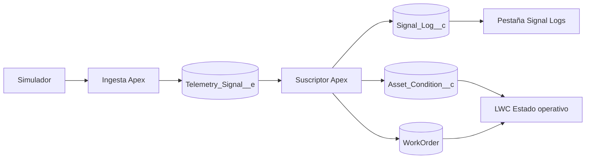
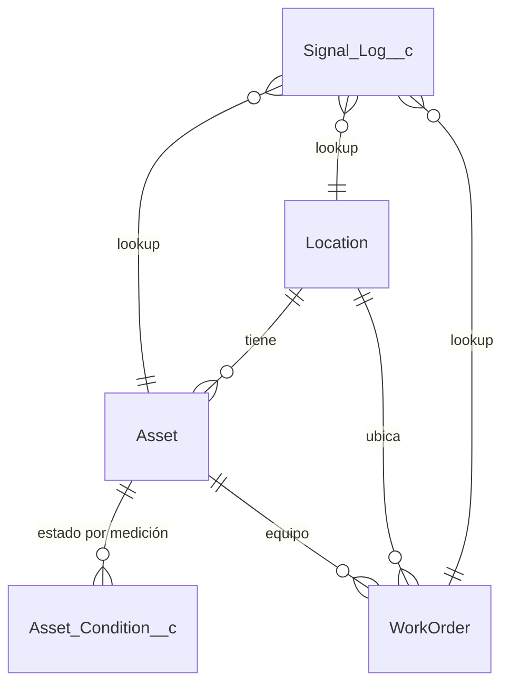
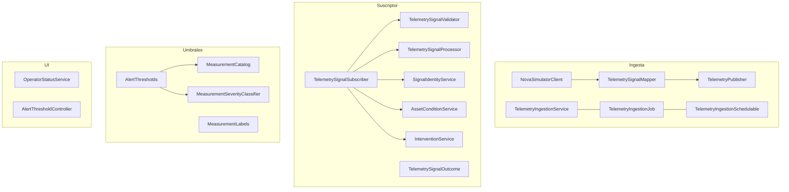

# Nova Casa · Sprint 2 — Documentación Técnica

| | |
|---|---|
| **Plataforma** | Salesforce · API 67.0 · SFDX |
| **Org** | `novacasa` |
| **Repositorio** | https://github.com/duvanSFDC/nova-casa |
| **ZIP del proyecto** | GitHub → *Code → Download ZIP*, o `git archive -o nova-casa.zip HEAD` |

> **Qué cubre este documento:** todos los componentes diseñados y creados para la solución —
> objetos y campos, código Apex, Lightning Web Components, automatización, interfaz,
> analítica, seguridad e integración— listados y explicados.

---

## Contenido

1. [Resumen de la solución](#1-resumen-de-la-solución)
2. [Convenciones y buenas prácticas](#2-convenciones-y-buenas-prácticas)
3. [Modelo de objetos y campos](#3-modelo-de-objetos-y-campos)
4. [Código Apex](#4-código-apex)
5. [Lightning Web Components](#5-lightning-web-components)
6. [Automatización declarativa (Flows)](#6-automatización-declarativa-flows)
7. [Interfaz y experiencia](#7-interfaz-y-experiencia)
8. [Analítica (dashboard y reporte)](#8-analítica-dashboard-y-reporte)
9. [Seguridad y accesos](#9-seguridad-y-accesos)
10. [Integración](#10-integración)
11. [Despliegue y pruebas](#11-despliegue-y-pruebas)

---

## 1. Resumen de la solución

Las señales IoT de los edificios llegan desde un simulador, entran a Salesforce como
**Platform Event**, se validan y se registran. Con cada señal válida se actualiza el estado
del equipo; una lectura crítica abre una intervención. Cada rol (operadora, coordinador,
gerente, administradora) ve solo lo que le corresponde.



---

## 2. Convenciones y buenas prácticas

| Práctica | Cómo se aplica |
|---|---|
| **Sharing explícito** | Plomería (ingesta, suscriptor, servicios internos) → `inherited sharing`. Servicios de usuario final → `with sharing`. |
| **Modo de ejecución (API 67)** | Ingesta y suscriptor (cuentas técnicas) → `SYSTEM_MODE`. Clases de UI → `USER_MODE` (respeta CRUD/FLS/sharing). |
| **Bulkificación** | Sin SOQL/DML en bucles. El suscriptor cuesta **≤ 6 consultas y 3 escrituras por lote**, traiga 1 o 200 señales. |
| **Guardado parcial** | `Database.insert/upsert(…, false, …)`: una señal inválida no tumba a las válidas. |
| **Secretos fuera del repo** | El token vive solo en la Credential `Nova_Simulator`; el payload crudo nunca se copia al log. |
| **Trigger flaco** | El trigger solo delega; la lógica vive en clases. |
| **Pruebas** | Una clase de prueba por clase de producción, con mock de HTTP y fábrica de datos. |

---

## 3. Modelo de objetos y campos

### 3.1 Diagrama de relaciones



> Solo se usan **lookups** (sin master-detail). `Alert_Threshold__c`, `Ingestion_State__c` y
> `Telemetry_Signal__e` no se relacionan por lookup: Apex los cruza por código/llave.

### 3.2 Objetos estándar extendidos

**`Location`** — el edificio.

| Campo | Tipo | Para qué |
|---|---|---|
| `External_Id__c` | Text (único) | Código del edificio (`BLD-BOG-001`) con el que llega la señal |

**`Asset`** — el equipo (bomba, medidor, cámara…).

| Campo | Tipo | Para qué |
|---|---|---|
| `External_Id__c` | Text (único) | Código del equipo (`AST-BOG-PUMP-001`) |
| `Asset_Type__c` | Picklist | Tipo (`WATER_PUMP`, `WATER_METER`, `SECURITY_CAMERA`…); define qué medición y unidad acepta |
| `Building_Code__c` | Text | Copia del código del edificio (lo pone un flujo) para las reglas de compartición |
| `Location__c` | Lookup | Relación auxiliar al edificio |

**`WorkOrder`** — la intervención.

| Campo | Tipo | Para qué |
|---|---|---|
| `Message_Key__c` | Text (único) | `messageId` que originó el trabajo; **candado anti-duplicado** (BR-205) |
| `Building_Code__c` | Text | Código del edificio para compartición |

### 3.3 Objetos custom

**`Asset_Condition__c`** — estado actual, **una fila por activo + tipo de medición**.

| Campo | Tipo | Para qué |
|---|---|---|
| `Asset_Measurement_Key__c` | Text (único) | Llave `AssetId:tipo` para el upsert idempotente |
| `Asset__c` | Lookup (obligatorio) | Equipo |
| `Measurement_Type__c` / `Measurement_Value__c` / `Measurement_Unit__c` | Text / Number / Text | La lectura |
| `Occurred_At__c` | DateTime | Hora de origen; decide cuál es la lectura más reciente (BR-203) |
| `Severity__c` | Picklist | `Normal` / `Warning` / `Critical` |
| `Communication_Status__c` | Picklist | `OK` / `LOST` / `RESTORED` (conectividad) |
| `Sensor_Id__c` | Text | Sensor que reportó |
| `Building_Code__c` | Text | Código del edificio para compartición |

**`Signal_Log__c`** — la traza de cada señal (BR-209).

| Grupo | Campos |
|---|---|
| **Identidad** | `Message_Id__c`, `Delivery_Id__c`, `Event_Uuid__c`, `Replay_Id__c` |
| **Estado técnico** | `Status__c` (`Published` / `Processed` / `Publish_Failed`) |
| **Resultado de negocio** | `Result__c` (`Accepted` / `Rejected` / `Duplicate` / `Late`), `Reason__c`, `Error__c`, `Retry_Safe__c`, `Severity__c` |
| **Investigación (fórmulas)** | `Investigation_Status__c` (etapa + resultado + motivo), `Retry_Guidance__c` (qué hacer) |
| **Fechas** | `Occurred_At__c`, `Source_Published_At__c`, `Published_At__c`, `Processed_At__c` |
| **Referencias** | códigos `Building_Id__c` / `Asset_Id__c`; lookups `Asset__c`, `Location__c`, `Work_Order__c` |

**`Alert_Threshold__c`** — los límites por tipo de equipo y medición (BR-204).

| Campo | Tipo | Para qué |
|---|---|---|
| `Threshold_Key__c` | Text (único) | Llave `TIPO_EQUIPO|MEDICIÓN` |
| `Asset_Type__c` / `Measurement_Type__c` | Text | A qué equipo y medición aplica |
| `Unit__c` | Text | Unidad válida de esa medición |
| `Alert_Direction__c` | Picklist | `Above` / `Below` (hacia dónde empeora) |
| `Warning_Limit__c` / `Critical_Limit__c` | Number | Los dos límites |

> **Reglas de validación:** `Limits_Required` (no vacíos), `Limits_Contradictory` (el crítico
> debe ser más grave que la advertencia), `Key_Matches_Types` (la llave coincide con los tipos).

**`Ingestion_State__c`** — el cursor del simulador (registro `default`, y `scenario` para pruebas).

| Campo | Tipo | Para qué |
|---|---|---|
| `Cursor__c` | LongTextArea | Cursor de paginación (supera 255, por eso es objeto y no Custom Setting) |
| `Session_Started_At__c` / `Session_Expires_At__c` | DateTime | Vigencia de la sesión (30 días) |
| `Has_More__c` | Checkbox | Si el simulador tiene más datos |
| `Poll_After_Ms__c`, `Last_Run_At__c`, `Last_Batch_Count__c` | Number / DateTime / Number | Telemetría de la última corrida |

**`Telemetry_Signal__e`** — el Platform Event (el contrato de la señal). 21 campos: identidad
(`Message_Id__c`, `Delivery_Id__c`, `Source__c`), edificio/activo/medición/comunicación, fechas
y `Raw_Payload__c` (el mensaje crudo, **solo en el evento**, nunca en el log).

**`Asset_Signal_Log__c`** — objeto sin uso ni registros; queda privado hasta decidir si se elimina.

---

## 4. Código Apex

### 4.1 Mapa de capas



### 4.2 Capa de ingesta — lee del simulador y publica al bus

| Clase | Sharing | Qué hace | Puntos clave |
|---|---|---|---|
| `NovaSimulatorClient` | inherited | Cliente HTTP del simulador | `startSession`, `fetchTelemetry`, `isHealthy`, `fetchCatalog`. Usa la Named Credential `callout:Nova_Simulator`; el token nunca lo ve. Timeout 20 s. |
| `TelemetrySignalMapper` | inherited | Traduce el JSON del simulador a `Telemetry_Signal__e` | `toEvent`, `parseDatetime`. No valida ni clasifica. |
| `TelemetryPublisher` | inherited | Publica al bus y deja un log `Published` por señal | `publish` (`EventBus.publish` + log). Si no se publica, el log queda `Publish_Failed` con `Retry_Safe = true`. |
| `TelemetryIngestionService` | inherited | Orquesta una corrida (sesión → lote → publicar → guardar cursor) | `run` (ingesta normal), `runScenario` (escenarios deterministas). **Callouts antes de DML.** |
| `TelemetryIngestionJob` | inherited | Ingesta asíncrona | `Queueable, AllowsCallouts`. Se re-encola (1/min) mientras el simulador diga `hasMore`. |
| `TelemetryIngestionSchedulable` | inherited | Dispara la ingesta por Cron | Un Schedulable no hace callouts: **encola** el Job. |

### 4.3 Capa de suscripción y procesamiento — una transacción por lote

| Clase | Rol (BR) | Qué hace | Puntos clave |
|---|---|---|---|
| `TelemetrySignalSubscriber` | Orquestador | Ejecuta todo el pipeline y escribe el log de cada señal | Guardado parcial `SYSTEM_MODE`; no relanza el lote. |
| `TelemetrySignalValidator` | Apex A (202) | Revisa que la señal traiga lo que exige su tipo | `validate` → rechazo o `null`. **No consulta nada.** |
| `TelemetrySignalProcessor` | Apex B1 (202/204) | Reconoce edificio y equipo, valida unidad, clasifica severidad | `process` → **1 SOQL a `Location` + 1 a `Asset`** por lote. Un código inexistente se rechaza. |
| `SignalIdentityService` | Dedup (205) | Aparta reenvíos (`Duplicate`) y conflictos (`IDENTITY_CONFLICT`) por `messageId` | `classifyDuplicates` → 1 SOQL. Dentro del lote y entre entregas. |
| `AssetConditionService` | Apex B2 (203) | Conserva la lectura más reciente por activo+tipo | `updateCurrentState` → 1 SOQL + 1 `upsert` por llave única. Una señal no más nueva queda `Late`. |
| `InterventionService` | Intervención (205) | Abre **una** intervención por crítica vigente | `ensureInterventions`. Dedup por `Message_Key__c`; falla segura (`INTERVENTION_FAILED`). Apex nunca cierra/avanza el WO. |
| `TelemetrySignalOutcome` | Modelo | Objeto de valor con la decisión por señal | Fábricas `accepted/rejected/late/duplicate`; `applyTo(log)`. Centraliza las constantes `RESULT_*` y `REASON_*`. |

### 4.4 Capa de umbrales, severidad y etiquetas

| Clase | Sharing | Qué hace | Puntos clave |
|---|---|---|---|
| `AlertThresholds` | inherited | Lee `Alert_Threshold__c` **una vez por transacción** (cache) | `all()`. Lo comparten el catálogo y el clasificador: 1 SOQL por lote. |
| `MeasurementCatalog` | inherited | Unidad esperada por tipo de equipo+medición | `unitFor`. Base de la validación `INCOMPATIBLE_UNIT`. |
| `MeasurementSeverityClassifier` | inherited | Clasifica `Normal` / `Warning` / `Critical` | `classify`. Según dirección y límites; sin umbral válido **no asume Normal** (devuelve `THRESHOLD_*`). |
| `MeasurementLabels` | inherited | Nombres amigables en español | `typeLabel`, `unitLabel`. Espejo de `labels.js`. |

### 4.5 Capa de servicios de UI (`with sharing`, `USER_MODE` → BR-208)

| Clase | Qué hace | Métodos `@AuraEnabled` |
|---|---|---|
| `OperatorStatusService` | Datos de la pantalla *Estado operativo* de Laura: una fila por lectura, estado del activo (peor severidad), intervención abierta | `getAssets(buildingId, severity)`, `getBuildings()` |
| `AlertThresholdController` | Datos de la pantalla *Umbrales de alerta* de Javier: lee y guarda **solo** los dos límites, con el permiso del usuario | `getThresholds()`, `saveLimits(changes)` |

### 4.6 Trigger y Platform Event

| Componente | Qué hace |
|---|---|
| `TelemetrySignalTrigger` | Trigger `after insert` de `Telemetry_Signal__e`; delega en `TelemetrySignalSubscriber.handle`. |
| `TelemetrySignalTriggerConfig` | Config del suscriptor: `batchSize = 200` eventos por invocación. |

### 4.7 Pruebas (cobertura determinista)

| Clase de prueba | Qué cubre |
|---|---|
| `TelemetryIngestionServiceTest`, `TelemetryIngestionCursorTest` | Ingesta, sesión y cursor |
| `TelemetryPublisherTest` | Publicación y log `Published` / `Publish_Failed` |
| `TelemetrySignalValidatorTest` | Apex A: señales incompletas / tipo desconocido |
| `TelemetrySignalProcessingTest` | Lote mixto, 200 señales, costo 1 ≈ 200 (BR-202) |
| `TelemetryStateProcessingTest` | Recencia, empate, conectividad (BR-203) |
| `MeasurementSeverityClassifierTest`, `TelemetrySignalSeverityTest`, `AlertThresholdsTest` | Severidad en bandas y en límites (BR-204/206) |
| `InterventionProcessingTest` | Crítica→1 intervención, reenvío, conflicto, atrasada, falla segura (BR-205) |
| `OperatorStatusServiceTest`, `OperatorAccessTest` | Pantalla de Laura y aislamiento por rol (BR-208) |
| `AlertThresholdAccessTest`, `AlertThresholdControllerTest` | Quién edita umbrales y reglas de validación |
| `SignalLogInvestigationTest`, `SignalLogSensitiveDataTest` | Investigación y que el log no filtra secretos (BR-209) |
| `BuildingCodeFlowTest`, `MeasurementLabelsTest` | Flujos de código de edificio y etiquetas |
| **Utilidades** | `NovaSimulatorMock` (HttpCalloutMock), `AlertThresholdTestData` (fábrica) |

---

## 5. Lightning Web Components

### `operatorStatus` — pantalla *Estado operativo* (Laura)
- **Targets:** App Page, Home Page, Tab. **Apex:** `OperatorStatusService`.
- **Qué muestra:** tabla de equipos con severidad (ícono + texto), filtros de edificio y severidad, hora de consulta e intervención abierta.
- **Propiedades de diseño (`@api`)** para el inicio: `urgentOnly` (solo crítico/advertencia) y `showSummary` (contadores).
- **Pruebas (Jest):** `toTableRow`, `computeSummary`, `isUrgentAsset`. Etiquetas en `labels.js`.

### `alertThresholdEditor` — pantalla *Umbrales de alerta* (Javier)
- **Targets:** App Page, Tab. **Apex:** `AlertThresholdController`.
- **Qué muestra:** tabla de umbrales con **edición en línea solo de los dos límites**; aviso al guardar; error por fila cuando una regla de validación rechaza.
- **Pruebas (Jest):** `toTableRow`, `mergeDrafts`, `toDatatableErrors`.

---

## 6. Automatización declarativa (Flows)

Tres *record-triggered flows* copian el código del edificio al campo `Building_Code__c`, porque
las reglas de compartición no pueden filtrar por un lookup.

| Flow | Objeto | Qué hace |
|---|---|---|
| `Asset_Building_Code` | Asset | Copia el código del edificio al crear/editar el equipo |
| `Asset_Condition_Building_Code` | Asset_Condition__c | Copia el código del edificio a la lectura |
| `Work_Order_Building_Code` | WorkOrder | Copia el código del edificio a la intervención (corre en la misma transacción que la crea Apex) |

---

## 7. Interfaz y experiencia

| Componente | Tipo | Descripción |
|---|---|---|
| `Nova_Casa` | Lightning App | App de la solución. Pestañas: Inicio, Estado operativo, Intervenciones, Signal Logs, Umbrales de alerta. Marca: logo + color `#D07E43`. |
| `Nova_Casa_Home` | FlexiPage (Home) | Inicio por rol: cada tarjeta se muestra según un custom permission (dashboard de gerencia, Estado operativo, intervenciones, señales fallidas). |
| `Asset_Record_Page` | FlexiPage (Record) | Ficha del activo con su historial de intervenciones. |
| `Estado_Operativo` | Tab | Expone el LWC `operatorStatus`. |
| `Umbrales_de_Alerta` | Tab | Expone el LWC `alertThresholdEditor`. |
| `Signal_Log__c` | Tab | Lista de la traza para la administradora. |
| Asset / Signal Log / Work Order | Layouts | Fichas; la de Signal Log abre con la sección *¿Qué pasó y qué hago?*. |

---

## 8. Analítica (dashboard y reporte)

| Componente | Tipo | Descripción |
|---|---|---|
| `Intervenciones_por_edificio` | Report Type | Tipo de reporte con base `WorkOrder`. |
| `Intervenciones por edificio` | Report | Intervenciones agrupadas por edificio; alimenta el dashboard. Vive en la carpeta `NovaCasaOperacion`. |
| `Estado de Edificios` | Dashboard | **Dinámico** (`dashboardType = LoggedInUser`): cada gerente ve solo su región. Dona (intervenciones por edificio) + tabla de detalle. Vive en la carpeta `Gerencia`. |
| `Gerencia`, `NovaCasaOperacion` | Carpetas | Compartidas (solo lectura) a los grupos de región `Nova_Gerencia_Andina` y `Nova_Gerencia_Caribe`. |

---

## 9. Seguridad y accesos

> La seguridad se aplica en el servidor, no solo en la pantalla: los **permission sets** ponen el
> techo de objetos/campos y las **reglas de compartición** deciden qué registros ve cada quien.

**Perfiles**

| Perfil | Uso |
|---|---|
| `Minimum Access - Salesforce` | Base de todas las personas (acceso mínimo + app Nova Casa) |
| `Admin` | Administración de plataforma |

**Permission sets**

| Permission set | Persona / uso | Alcance |
|---|---|---|
| `Nova_Operator` | Laura (operadora) | Lectura de edificios/activos/condición/WO de sus edificios + pantalla Estado operativo |
| `Nova_Coordinator` | Javier (coordinador) | Lectura + avanza/cierra WO; edita los límites de los umbrales |
| `Nova_Manager` | Armando / Hernando (gerentes) | Solo lectura por región + dashboard |
| `Nova_Admin` | Camila (administradora) | Pestañas de la app + tarjeta de señales rechazadas del inicio. Camila es **System Administrator** (mayor privilegio + objetos de telemetría, directriz de Emiliano); su amplitud de datos la da el perfil |
| `Nova_Integration` | Usuario de integración | Objetos y clases de la ingesta |
| `Nova_Simulator_Access` | Usuario de integración | Acceso a la External Credential del simulador |

**Custom permissions** (gobiernan la visibilidad de las tarjetas del inicio)

| Custom permission | Lo tiene | Muestra |
|---|---|---|
| `Ver_Intervenciones_Operador` | Operador | Tarjetas del inicio de Laura |
| `Ver_Intervenciones_Coordinador` | Coordinador | Intervenciones en el inicio de Javier |
| `Ver_Dashboard_Edificios` | Gerente | Dashboard de edificios |
| `Ver_Logs_Senal` | Administradora | Lista de señales rechazadas |

**Grupos públicos**

| Grupo | Para qué |
|---|---|
| `Nova_Building_BOG` / `BAQ` / `MDE` | Un grupo por edificio (acceso del operador a su sede) |
| `Nova_Coordination` | El coordinador ve todos los edificios |
| `Nova_Gerencia_Andina` / `Nova_Gerencia_Caribe` | Cada gerente ve su región |

**Roles (jerarquía):** `Gerencia_Regional` › `Coordinacion` › `Operacion` / `Administracion`.

**Reglas de compartición** (OWD privado): por criterio sobre `External_Id__c` / `Building_Code__c`,
otorgan lectura al grupo del edificio, la región o la coordinación. Definidas en `Location`,
`Asset`, `Asset_Condition__c` y `WorkOrder`.

---

## 10. Integración

| Componente | Descripción |
|---|---|
| External / Named Credential `Nova_Simulator` | Guarda el token en el principal `Nova_Team`. Se configura en la org; **no** está en el repo. El acceso lo concede `Nova_Simulator_Access`. |
| `TelemetrySignalTriggerConfig` | El suscriptor recibe hasta 200 eventos por invocación. |

---

## 11. Despliegue y pruebas

```bash
# Desplegar con pruebas Apex
sf project deploy start --source-dir force-app --target-org novacasa \
  --test-level RunSpecifiedTests --tests TelemetryIngestionServiceTest ... (lista completa en README)

# Pruebas de los LWC (Jest)
npm install && npm run test:unit
```
